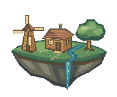

# Floating garden

Original pixel art authored with the pixel-art and pixloom skills.

- `spritesheet.png`: transparent 1152 × 640 PNG, 6 columns × 4 rows, chronological left to right. Each cell is 192 × 160.
- `floating-garden.png`: transparent first frame.
- `floating-garden.gif`, `.apng`, `.webp`: infinite 24-frame loops, 150 ms per frame (3.6 seconds). Identical four sails rotate 90° per loop, equivalent to a 14.4-second full turn.
- `floating-garden.pixloom.json`: optimized version-2 editable palette-index authority. Six layers separate rock, meadow, architecture, tree, water, and sails.
- `floating-garden.pxo`, `.aseprite`: editable native projects; static layers explicitly linked across frames.
- `preview.html`: animated light/dark README theme preview at 2× nearest-neighbor scale.
- `theme-review.png`: light/dark review at 1×, 2×, and enlarged 4× (enlarged sample is cropped vertically).

Validation: pixloom schema validation and Aseprite inspection passed. Still, contact sheet and light/dark theme review visually inspected. Export loop fields verified; animation playback has not been visually inspected.

Rebuild: run `python generate.py`, then pixloom build/export/render using the paths above. Run `python set-infinite-loop.py` after exporting: pixloom 0.2.0 exports one playback by default. The script changes only GIF/APNG/WebP repeat metadata (and APNG CRC). Run `python verify.py` before optimizing with `pixloom optimize floating-garden.pixloom.json --in-place`.

PNG spritesheets cannot animate themselves; use the GIF, APNG or WebP for a README.
